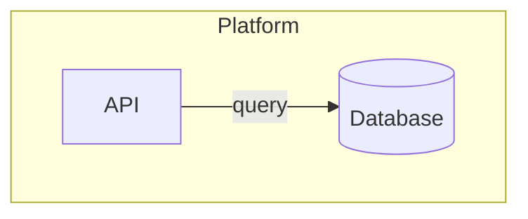

# Markdown, Mermaid, and exports

## Format selection

| Format | Carries | Limits |
| --- | --- | --- |
| `.marmerlade.json` | Nodes, edges, positions, fold state, element styles, images, document bodies and links | App appearance remains a browser setting |
| Mermaid flowchart | Structure, labels, supported shapes, leaf icons/images, document references | No document bodies, positions, fold state, element styles, or flow order |
| Wiki `body` | Markdown explanation, wikilinks, diagram embeds | Meaning depends on the workspace for links and live embeds |
| Deck `body` | Slide Markdown, notes, directives, objects, embeds | Live references depend on the workspace |
| Exported slide `.md` | Standalone deck with Mermaid snapshots and inline object CSS | Live embeds become snapshots; wikilinks become plain text |
| PDF | Rendered presentation pages | No editable workspace or live navigation contract |
| GIF | A rendered animation loop | No editable structure or document content |

## Wiki Markdown

Use ordinary Markdown plus these extensions:

| Syntax | Meaning |
| --- | --- |
| `[[Target]]` | Wiki link resolved by page title, then by node label |
| `[[Target\|Alias]]` | The same lookup with different visible text |
| `[[deck:Title]]`, `[[diagram:Title]]` | Link to a deck, or a canvas diagram, by title |
| `{{diagram}}` on its own line | Embed the sub-diagram for the current linked node |
| `{{diagram:Target}}` on its own line | Embed the node matching the exact ID, otherwise its label, otherwise the whole diagram with that title |
| `{{sequence:Title}}` on its own line | Embed the sequence diagram with that title |
| A fenced `mermaid` block | Render a diagram stored in the document itself |

Wikilinks compare trimmed titles and labels case-insensitively. A page title
takes priority over a node label; the first matching page or node wins. A node
link opens its default page, creating one on first visit if needed. Page IDs
are not the wikilink lookup key. Avoid ambiguous duplicate titles.

An explicit embed checks a node ID first, then its label. Prefer an ID for a
target that should survive renaming. Bare embeds are context-sensitive: a page
shared by several nodes can show a different diagram depending on which node
opened it. Use an explicit target when that variation is not intended.

Embed scope is defined by `embedDiagram`:

- A group contributes its entire subtree, excluding the group node itself.
- A leaf contributes itself, its direct incoming/outgoing neighbors, and edges
  whose endpoints are both in the result.
- Page/deck attachment fields are removed from the embedded nodes. The embed
  does not copy a separate persistent diagram into the document.

Do not assume a live Mermaid embed reproduces the canvas's folding, positions,
styling, or animation. It derives current structure and renders through Mermaid.
External renderers may need icon support. Inspect renders when icons matter.
Prose around an embed stays authored text after a structural change.

The rich-text editor recognizes bare and targeted embeds. A page containing raw HTML uses Markdown editing to
preserve that content.

## Slide Markdown

Decks use a subset shared with Marp and Slidev. Front matter is optional and
must appear first. Separate slides with `---` on its own line and blank lines
around it so Markdown does not parse it as a heading underline.

```markdown
---
backgroundColor: '#211a2b'
color: '#f7e6cf'
font: sans
headingFont: sans
transition: fade
---

<!-- _class: lead -->

# System overview

The outcome this audience should understand.

---

## Request path

{{diagram:platform}}

Read [[Platform]] for the detailed design.

<!-- Explain the request path, then the failure case. -->
```

Interpreted front-matter and directive keys:

| Key | Values |
| --- | --- |
| `backgroundColor`, `color` | CSS color strings |
| `font`, `headingFont` | `sans`, `serif`, `mono`, `hand` |
| `transition` | `fade`, `slide` |
| `class` | `lead` for centered content; `invert` for swapped ink/paper |

`<!-- key: value -->` applies to this and subsequent slides.
`<!-- _key: value -->` applies only to this slide. Recognized Marp directives
such as `theme`, `paginate`, `header`, and `footer` are retained even where the
app does not interpret them. Other HTML comments are speaker notes, separated
from audience-visible content. Front matter is retained rather than displayed.

Decks support the same wikilinks, live embeds, and Mermaid fences as wiki pages.
Objects are individual HTML blocks in the slide source. Positions and sizes
use percentages of the slide; later objects paint on top of earlier ones.

```html
<div class="box round" style="left:10%;top:20%;width:35%;height:18%;background:#34233c;color:#fff0dd">A main message</div>
```

Object classes include `box` and a shape such as `rect`, `round`, `ellipse`,
`line`, `arrow`, or `image`; a plain `box` is text. Optional font classes use
the font names above. Relevant styles include `left`, `top`, `width`, `height`,
`background`, `border-color`, `color`, `font-size` in em, `text-align`, and
`transform: rotate(Ndeg)`. Images use an `img` inside a `box image` block.
Use the editor for positioning when available and inspect the slide in Present
view for overflow. Source validity does not establish visual fit.

## Mermaid flowchart subset

The workspace also accepts Mermaid `sequenceDiagram` source as `diagram.sequence`. Use `{{sequence}}` for a live wiki or slide embed. Sequence export reproduces the stored source.

For `flowchart` and `graph` input, `parseMermaid` is the strict parser;
unrecognized lines reject the edit so the live editor keeps its last good state.
Flowchart export uses `flowchart TD` regardless of imported layout direction.



| Model | Mermaid representation |
| --- | --- |
| Shape node | Classic brackets such as `api["API"]` or `db[("Database")]` |
| Icon tile | `db@{ icon: "lucide:database", form: "square", label: "Database" }` |
| Image node | `logo@{ img: "https://example.com/logo.png", label: "Logo", pos: "t", w: 80, h: 80, constraint: "on" }` |
| Group | `subgraph id ["Label"] ... end`, nested by `parentId` |
| Edge | `a --> b` or `a -->|label| b` |
| Default page link | `click id href "#/wiki/page_id"`, optionally with a configured base URL |
| All page links | `%% marmerlade-pages id ["page_a","page_b"]` |
| All deck links | `%% marmerlade-decks id ["deck_a"]` |

Modern `@{ shape: ... }` aliases map to supported shapes; unrecognized modern
shapes fall back to `rect`. Chains and `&` node groups expand into separate
edges. `-->`, `---`, `-.->`, and `==>` import as ordinary directed edges and
export as `-->`; their original stroke semantics are not preserved.

A standalone Mermaid round trip loses node positions, collapse state, element
styles, explicit flow steps, stable edge IDs, group shape/icon/image metadata,
and all page/deck bodies. Document reference comments do not contain the
documents. Preserve the workspace JSON for a complete editable result.

During a live text edit, `mergeDiagram` preserves surviving nodes' positions,
collapse state, styles, and unspecified document links by node ID. Parsed
labels, shapes, icons/images, and parent membership come from the new text.
Edge styles and flow order are preserved by endpoint pair; that matching is
ambiguous for differently styled parallel edges. Nodes and edges absent from
the parsed structure are removed. This merge behavior is not a property of the
Mermaid file itself.

## Output mechanics

- Browser Export file writes the complete workspace envelope. An MCP workspace
  saves the same format after successful commits.
- `export_mermaid` emits structure. Use `get_workspace` for complete data.
- Slide Export Markdown adds `marp: true`, replaces live embeds with Mermaid
  fences, turns wikilinks into plain text, and writes object styles inline.
  Slidev renders Mermaid fences; Marp requires a Mermaid plugin. HTML support
  is needed for positioned objects.
- Print from Present view for a PDF with one slide per sheet.
- Browser Export GIF records a loop of the diagram's animation. Playing or
  stepping a flow includes its sequence. A walkthrough recording is a separate
  artifact produced with browser capture, not the native diagram export.

Prefer current embeds for current structure and dated snapshots for historical
evidence. Neither export nor a live embed automatically updates explanatory
prose or guarantees another renderer's identical appearance.
