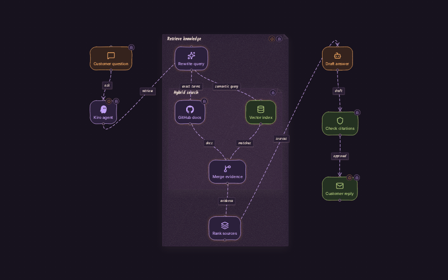
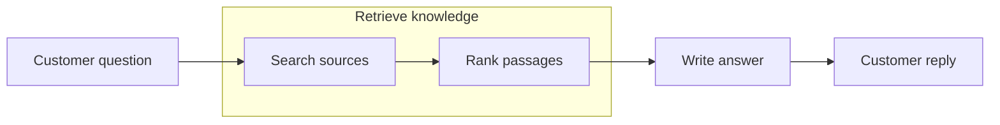

<div align="center">
  
  <h1>marmerlade</h1>
  <p><strong>Diagrams that fold. Docs and slides that stay in sync.</strong></p>
  <p>Draw your system once, then explain it at any depth: a one-card overview,<br>
  the full detail, and wiki pages and slides that update with the diagram.</p>
  <p>
    <a href="https://han002x.github.io/marmerlade/"><strong>Open Marmerlade in your browser →</strong></a>
  </p>
  <p>
    <a href="https://www.npmjs.com/package/marmerlade"></a>
    
    
  </p>
  <p>
    <a href="#try-it-now">Try it</a> ·
    <a href="#let-your-ai-assistant-draw-it">Use with AI</a> ·
    <a href="docs/usage.md">User guide</a> ·
    <a href="docs/mcp.md">MCP setup</a> ·
    <a href="#contributing">Contribute</a>
  </p>
</div>



<p align="center"><sub>A support workflow in Halloween mode, exported directly from Marmerlade as an animated GIF.</sub></p>

## Why Marmerlade?

Most architecture diagrams have one of two problems. They are either too simple
to be useful or too detailed to read. Marmerlade lets you have both.

- **Fold the detail away.** Collapse any group into a single card, then unfold
  it when someone asks "what's inside?". Connections follow the folded cards, so
  the overview stays accurate.
- **Explain it in one place.** Attach wiki pages and slide decks to the nodes
  they describe. Embedded diagrams update everywhere when you change the canvas.
- **Speak Mermaid.** Paste Mermaid to start, edit visually or in source, and
  export Mermaid when you need it somewhere else.
- **Hand it to your AI assistant.** Connect Claude Code, Codex, Cursor, Kiro, or
  Antigravity, and watch the canvas update live as it maps your codebase.

## What you can do

| | |
| --- | --- |
| 🪗 **Foldable diagrams** | Nest groups to any depth. Fold a whole level at once, or open one group at a time. |
| 🧜 **Mermaid editing** | Edit source beside the canvas. Edit flowcharts and sequence diagrams in the same workspace, then export either as Mermaid. |
| 📖 **Connected wiki** | Link pages to nodes, share a page across nodes, and follow wikilinks and backlinks. |
| 🎞️ **Markdown slides** | Write decks with live diagram embeds, speaker notes, and a presenter view. Print to PDF. |
| ▶️ **Flow playback** | Animate connections in sequence, step through a flow, or export the loop as a GIF. |
| 🤖 **Live AI canvas** | Let an assistant read and edit your workspace while the browser follows along. |
| ✒️ **Paper and ink** | Hand-drawn shapes, icons, and images, with paper, dark, blueprint, and other styles. |

## Try it now

Open **[han002x.github.io/marmerlade](https://han002x.github.io/marmerlade/)**.
No sign-up or install. Your work autosaves in your browser.

Use the product bar to switch between [Diagrams](https://han002x.github.io/marmerlade/#/diagrams),
[Wiki pages](https://han002x.github.io/marmerlade/#/wiki), and
[Slide decks](https://han002x.github.io/marmerlade/#/slides). You can create a page
or deck directly in its own editor and link it to diagram nodes later.

In Diagrams, press `M` to open the Mermaid panel and paste:



Then try these keys:

| Key | What happens |
| --- | --- |
| `F` | Select **Retrieve knowledge** and fold it into one card. Press again to unfold. |
| `W` | Open the selected node's wiki page. |
| `K` | Open the selected node's slide deck. |
| `P` | Play the flow from start to finish. |

To keep or share a workspace, choose **Export → Workspace file**. You get a
single `.marmerlade.json` file that anyone can open with **Import file**.

## Let your AI assistant draw it

Marmerlade includes a local [MCP](https://modelcontextprotocol.io) server. Your
assistant can create diagrams, write wiki pages, and build slides while you watch
the canvas update in your browser. Everything stays on your machine and saves to
a JSON file in your project.

**1. Install the CLI** (requires Node.js 22.12 or newer):

```bash
npm install -g marmerlade
```

**2. Run setup in your project.** Pick your assistant:

| Assistant | `--host` value |
| --- | --- |
| Claude Code | `claude` |
| Codex | `codex` |
| Cursor | `cursor` |
| Kiro | `kiro` |
| Antigravity | `antigravity` |

```bash
cd /path/to/your/project
marmerlade setup --project . --host claude --file architecture.marmerlade.json
```

Setup registers the MCP server, installs the Marmerlade skills, installs Chromium
for previews and exports, and checks the connection. It backs up any existing
configuration before changing it.

**3. Restart your assistant** (or reload its MCP servers), then ask:

> Use marmerlade-director to explain this project's architecture. Create a
> diagram with foldable groups, attach wiki pages to the main components,
> and open the live canvas.

The canvas opens in your browser and fills in as your assistant works. Changes
save to `architecture.marmerlade.json`, so you can commit them with your code.

<details>
<summary><strong>Troubleshooting and other setups</strong></summary>

- **Something isn't connecting?** From your project directory, run
  `marmerlade doctor --file architecture.marmerlade.json`.
- **Updating:** run `npm install -g marmerlade@latest`, then restart your
  assistant's MCP connection.
- **Other MCP clients**, such as Claude Desktop: see
  [manual configuration](docs/mcp.md#connect-an-assistant).
- **Running from a source checkout:** see [build from source](docs/mcp.md#build-from-source)
  and [guided local setup](docs/mcp.md#guided-local-setup).
- The web app and the CLI keep separate workspaces. The web app saves in your
  browser. The CLI saves to the file you pass with `--file`.

</details>

## Take your work anywhere

| Format | What it contains |
| --- | --- |
| `.marmerlade.json` | Everything: diagrams, styling, positions, fold state, wiki pages, and slide decks. |
| Mermaid | Diagram structure and page and deck references. |
| Slide Markdown | A standalone deck with diagrams converted to Mermaid fences, ready for Slidev. Marp needs a Mermaid plugin. |
| PDF / GIF | Print a presentation to PDF, or export flow playback as an animated GIF. |

Mermaid import supports a [flowchart subset](docs/usage.md#mermaid-support),
including subgraphs, classic shapes, labeled edges, and icon metadata. It also
opens [Mermaid sequence diagrams](docs/usage.md#sequence-diagrams) as entities alongside flowcharts on one workspace canvas. Each workspace can hold multiple diagrams of either type.

## Learn more

| Guide | Read it for |
| --- | --- |
| [User guide](docs/usage.md) | Canvas controls, folding, wiki, slides, appearance, and keyboard shortcuts. |
| [MCP and live canvas](docs/mcp.md) | Assistant setup, the tool reference, workspace files, and recovery. |
| [Data model](ONTOLOGY.md) | Entities, relationships, Mermaid mapping, and document syntax. |
| [Development](docs/development.md) | Building from source, checks, source layout, and packaging. |
| [Design principles](DESIGN.md) | The UI and architecture principles behind the project. |

## Contributing

Bug reports, documentation fixes, and pull requests are welcome. For bugs,
include steps to reproduce and, if you can, a small Mermaid or JSON example.
Please open an issue to discuss larger changes before you start.

To run Marmerlade locally:

```bash
git clone https://github.com/han002x/marmerlade.git
cd marmerlade
npm install
npm run dev
```

Before opening a pull request, run:

```bash
npm run lint
npm test
npm run test:mcp
npm run build
```

For UI changes, also run the browser tests. See [development](docs/development.md)
for the full checklist.

<sub>Built with React, TypeScript, React Flow, Zustand, Dagre, and Tiptap.</sub>

## License

[MIT](LICENSE)
