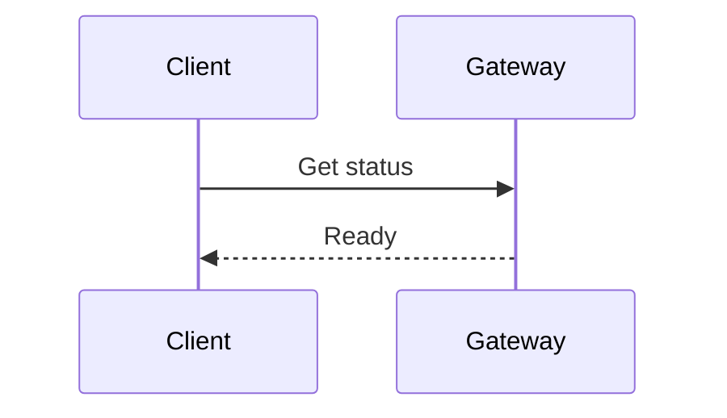

# MCP and live canvas

[Back to the README](../README.md) · [Data model](../ONTOLOGY.md)

Marmerlade includes a local MCP server and the built browser app. Your assistant
can edit the workspace while you follow the changes on the canvas.
Node.js 22.12 or newer is required.

## Build from source

From your checkout:

```bash
npm install
npm run build
node dist/cli.js --file ./architecture.marmerlade.json
```

The server prints its browser URL to stderr. Open that URL, or ask your assistant
to call `open_workspace`. The MCP connection uses stdin/stdout, so running the
command in a terminal alone does not register it with an assistant.

## Guided local setup

The package includes director, codebase-map, docs, and setup skills. Configure a project with:

```bash
node dist/cli.js setup --project /absolute/project --host both --file architecture.marmerlade.json
```

Choose `codex`, `kiro`, `claude`, `cursor`, `antigravity`, or `both` (codex and
kiro). Config and skills go to:

| Host | MCP config | Skills |
| --- | --- | --- |
| codex | `.codex/config.toml` | `.agents/skills` |
| kiro | `.kiro/settings/mcp.json` | `.kiro/skills` |
| claude | `.mcp.json` | `.claude/skills` |
| cursor | `.cursor/mcp.json` | `.cursor/skills` |
| antigravity | `~/.gemini/antigravity/mcp_config.json` (user-level) | `.agent/skills` |

Setup installs Chromium if missing, copies
skills to the host's project discovery directory, merges MCP
configuration, and verifies a real child MCP connection. It preserves unrelated
settings and creates a backup before changing an existing config. Repeating it
with the same options leaves configuration unchanged. Conflicting existing
entries require another `--name` or explicit `--replace`. `--no-browser` skips
browser installation and still requires an available working Chromium.

Reload MCP and skills in the selected host after setup. Call `get_workspace` and
`diagnose_environment`. Hosted image generation belongs to the host agent: reuse
its existing tool, save images inside the project, and import them with
`import_image`. Setup neither supplies an image provider nor handles its keys.

If Node.js or the package has not been installed, source checkouts include:

```bash
bash scripts/bootstrap.sh --project /absolute/project --host codex
```

Windows PowerShell:

```powershell
& .\scripts\bootstrap.ps1 -Project C:\project -AgentHost kiro
```

Bootstrap reuses compatible Node/npm or downloads a user-local Node 22 runtime,
verified against Node.js's official SHA-256 manifest. It builds a source checkout
or installs a supplied trusted tarball via `--package` on POSIX / `-Package` on
PowerShell. It does not assume this package has been published to npm. Chromium
may need system libraries on a minimal Linux machine; doctor reports the launch
failure and the host agent can address it with its normal installation policy.

Run `node dist/cli.js doctor --file /absolute/project/architecture.marmerlade.json`
when MCP cannot start. Run `node dist/cli.js serve --file /absolute/project/architecture.marmerlade.json --open`
for a standalone browser session after stopping any MCP process owning that file.
No FFmpeg, Python, or local image model is required for native rendering.

## Connect an assistant

Use absolute paths for both the built CLI and workspace file because client
working directories vary. Replace the paths below with your own, and merge the
entry into any existing configuration. Stop any terminal instance using the same
workspace file before connecting the assistant.

### Kiro

Add this to `.kiro/settings/mcp.json` in your workspace, or
`~/.kiro/settings/mcp.json` for all workspaces:

```json
{
  "mcpServers": {
    "marmerlade": {
      "command": "node",
      "args": [
        "/absolute/path/to/marmerlade/dist/cli.js",
        "--file",
        "/absolute/path/architecture.marmerlade.json"
      ],
      "disabled": false
    }
  }
}
```

Save the file. Kiro reconnects automatically when the configuration changes.
You can open the workspace file through the command palette with
**Kiro: Open workspace MCP config (JSON)**.
See [Kiro's MCP configuration guide](https://kiro.dev/docs/mcp/configuration/).

### Codex

Add this to `~/.codex/config.toml`, or `.codex/config.toml` in a trusted project:

```toml
[mcp_servers.marmerlade]
command = "node"
args = [
  "/absolute/path/to/marmerlade/dist/cli.js",
  "--file",
  "/absolute/path/architecture.marmerlade.json"
]
```

Alternatively, register the server with the CLI:

```bash
codex mcp add marmerlade -- node /absolute/path/to/marmerlade/dist/cli.js --file /absolute/path/architecture.marmerlade.json
```

Use `codex mcp list` to check registration and `/mcp` in a Codex session to
inspect active servers. The CLI and IDE extension share the configuration.
See [Codex's MCP guide](https://developers.openai.com/codex/mcp/).

### Other clients

For clients using `mcpServers` JSON, such as Claude Desktop and Cursor:

```json
{
  "mcpServers": {
    "marmerlade": {
      "command": "node",
      "args": [
        "/absolute/path/to/marmerlade/dist/cli.js",
        "--file",
        "/absolute/path/architecture.marmerlade.json"
      ]
    }
  }
}
```

Restart the MCP connection after changing its configuration. Client configuration is changed only by the explicit `setup` command or your
own edits.

### Check the connection

Ask your assistant to call `get_workspace`, then `open_workspace`. The first
returns the document and revision; the second opens the live browser canvas.
Edits through MCP update the browser and save to the workspace JSON file.

### After the npm release

Once the package is published, you can start it with:

```bash
npx -y marmerlade --file ./architecture.marmerlade.json
```

In your client configuration, use `"npx"` as the command and
`["-y", "marmerlade", "--file", "/absolute/path/architecture.marmerlade.json"]`
as the arguments.

## Tools and resources

- `get_workspace` returns the complete document, revision, file path and canvas URL.
- `apply_changes` takes the revision and an atomic `changes` array. Operations are
  `put_diagram`, `put_node`, `put_edge`, `put_page`, `put_deck`, `delete_diagram`,
  `delete_node`, `delete_edge`, `delete_page`, and `delete_deck`. Put operations
  replace the entity by ID. Document puts take `{id, title, body}`; the server
  sets `updatedAt`. Pass `dryRun: true` to validate a batch without writing it.
- `import_mermaid` takes `revision`, `source`, optional `diagramId`, and optional `tidy` (default true).
  It replaces diagram structure while preserving existing document content and
  surviving nodes' styling. New page/deck references create empty documents.
- `export_mermaid` takes optional `diagramKind` and `diagramId`, and returns structure as Mermaid. JSON preserves all content.
- `open_workspace` accepts `view` (`canvas`, `node`, `wiki`, `slides`) and an optional
  `id` to open a particular item. `node` requires an ID.
- `diagnose_environment` checks Node, packaged UI, project access, and Chromium.
- `list_icons` finds supported IDs by query and group, with pagination.
- `import_image` normalizes a project-local file and updates a target node using
  `revision`, `nodeId`, and `path`. The original file is preserved.
- `layout_diagram` measures labels in the actual app, arranges the expanded graph,
  and saves positions without changing folds or documents. It takes `revision`
  and optional `direction` (`TB` or `LR`). Inspect previews after arranging.
- `render_preview` returns a PNG and diagnostics for an isolated revision. Choose
  `view` (`canvas`, `wiki`, `slides`), document `id`, optional `nodeId`, `slide`,
  `fold` (`current`, `expanded`, `collapsed`), `appearance`, `width`, and `height`.
  Still captures finish finite animations, including slide entrances.
- `export_gif` queues native canvas animation from the selected revision. It takes
  the same canvas render options plus `fps`, `maxWidth`, and `flow`. Poll
  `get_render_job` with its `jobId` for progress, a completed file, or an error.
- `marmerlade://guide` describes the model and Markdown syntax;
  `marmerlade://example` contains a complete linked example.
- Prompts `map_codebase` (`path`, optional `focus`) and `refresh_diagram` (optional
  `scope`) start the codebase-map workflow. Tools declare read-only or destructive
  annotations so hosts can ask for approval only where data can change.

Read `get_workspace` before editing and pass its revision to the edit tool.
All operations in a batch are validated together. Deleting a node removes its
subtree and incident edges, retaining wiki pages and decks. Deleting a document
unlinks it from all nodes. Parent cycles and missing references are rejected.

Previews and exports save under `marmerlade-output/` beside the workspace file.
They do not change the live view. Preview diagnostics include unrelated-node
and sheet overlaps, clipping, small labels, broken images, browser errors, and
slide overflow. Export jobs pin their requested revision and remain responsive
to polling. The server processes one render operation at a time with a bounded
queue. Closing it cancels unfinished jobs. Use the packaged docs skill's MCP
reference for option bounds and image limits.

## Saving and recovery

Without `--file`, the server uses `./diagram.marmerlade.json` in its working
directory. One process owns each workspace file; a second writer is rejected.
The file is created on the first successful edit and saved atomically. Workspaces with diagram entities use version 5. Older version 3 and 4 files remain readable.
Existing version 1–3 files and bare diagram JSON are accepted. Do not edit the file
externally while the server owns it. Stop the server first. Locks from a crashed
process expire automatically after the lock heartbeat becomes stale.

Canvas, wiki and slide windows follow the same server workspace. Remote updates
reset the browser's diagram undo history so undo cannot revive stale state.
Conflicting edits are rejected; the browser retains its draft and offers
**Download draft** and **Reload latest**. A disconnected window also keeps its
unsaved draft and reconnects automatically. Download it before discarding or
reloading the window. Browser requests are limited to 20 MiB, including images.

The regular `npm run dev` app continues to save to browser localStorage. That
storage is separate from MCP workspaces. Export a `.marmerlade.json` and pass its
path with `--file` to bring an existing browser document into the live workspace.

See [development](development.md) for checks and package verification.

### Work with both diagram types

Call `import_mermaid` with the current revision and Mermaid text. A source
starting with `sequenceDiagram` updates the sequence, while `graph` or
`flowchart` updates the flowchart. For example, import a flowchart first, read
its returned revision, then import the following sequence with that revision.



Pass `"diagramKind": "sequence"` to `export_mermaid`, `render_preview`, or
`open_workspace` for the sequence canvas. The default is `flowchart`. A
`get_workspace` snapshot includes both, and `{{sequence}}` embeds the current
sequence in a wiki page or deck.


### Diagram entities

The shared canvas stores diagram instances in `diagram.diagrams`. Each instance
has an `id`, `title`, `position`, `size`, and `kind`. A flowchart contains
`nodes` and `edges`. A sequence contains Mermaid `source`.

Use `put_diagram` with a complete `diagram` entity or `delete_diagram` with its
`id` in `apply_changes`. Supply `diagramId` to `import_mermaid` or
`export_mermaid` to address an instance. Import creates an instance if that ID
does not exist. The original top-level `nodes`, `edges`, and `sequence` fields
project the first instance of each type for existing tools.
