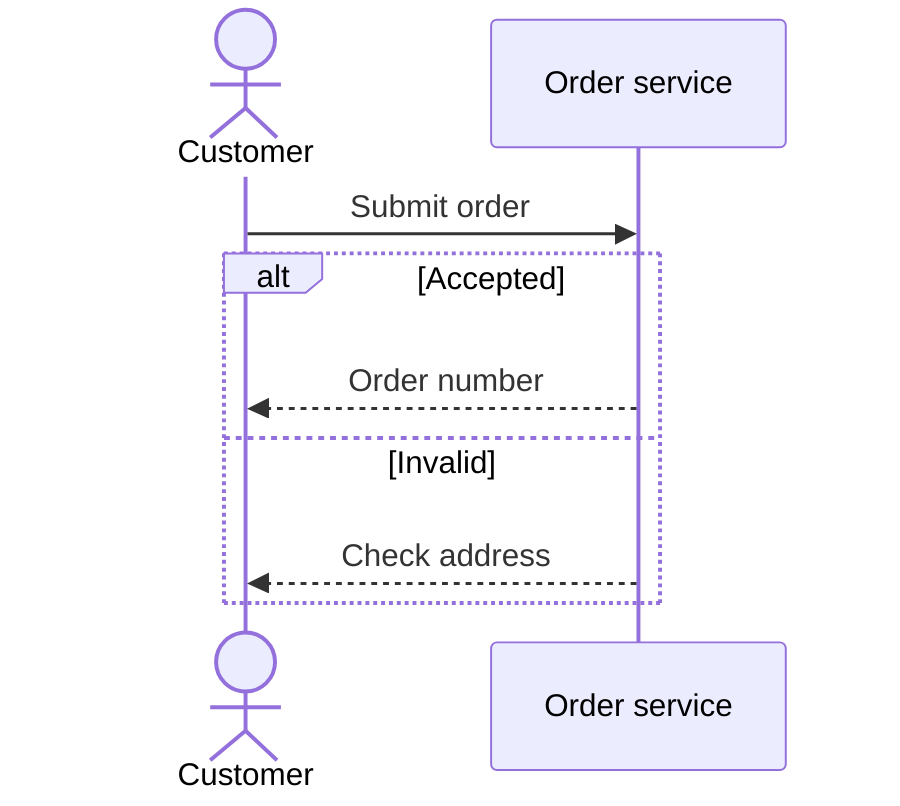

# User guide

[Back to the README](../README.md) · [Try the example](../examples/ai-support-agent/README.md)

## Infinite canvas

The workspace canvas holds multiple flowchart and sequence diagram entities.
Open **Add diagram** in the toolbar. Drag **Flowchart** or **Sequence** onto
the canvas, or choose a type and click where you want the diagram to start.
Drag a diagram by its name bar or preview to move it. Rename it in its header
or resize it when selected. Drag on empty canvas to select several diagrams,
then move, duplicate, or delete them together.

Click a diagram to edit it in place. Click empty canvas to finish.
Choose **Done** when finished. Drag flowchart nodes and draw edges between
handles. Pan or zoom anywhere on the workspace, or use the minimap to
navigate between diagrams. Built on [React Flow](https://reactflow.dev) (`@xyflow/react`).

## Origami folding

Any node that has children is a *group*, and an
unfolded group lies on a sheet of paper wrapping its subtree. Select the
sheet (or a node on it) and press `F` to fold: the subtree slides into the
group card and creases flat, leaving a card with its pages stacked beneath;
select the card and press `F` again to pop it back open. Edges into
a folded card crease onto the card (dashed, merged as `×n`) so folding never
loses connections. `[` / `]` fold or unfold the whole diagram one level at a
time. Nesting is arbitrary depth.

## Mermaid interop

The shared right panel edits the active diagram. In **Tree**, expand a diagram
row to see its contents, or click the row to activate that diagram. Flowcharts
list their nested node groups and connections. Sequences list participants and
messages. Edits in **Mermaid** sync live with the active diagram. Select nodes or connections in
the tree, or double-click their labels to rename them; changes update the
canvas and Mermaid source. **Copy** exports the source for other renderers.

## Auto-layout (dagre)

`L` / `⇧L` tidy the diagram top-down or left-right. Only visible nodes are
laid out, so tidying with a group folded re-flows the rest around its card.
Mermaid imports are tidied automatically.

## Motion

Nodes ease to their new positions on drag-end and Tidy (drag
itself tracks the cursor 1:1), lift and glow on hover, and show a live
animated **join preview** while you drag a new edge. The hovered node pulses
as the drop target and handles enlarge. All motion respects
`prefers-reduced-motion`.

## Sequenced flow

**P** plays a pulse along the connections in order: start
nodes (no incoming edge) first, branches together, each node lighting as the
pulse lands. `,` / `.` step back and forward, and the speed button cycles
½× / 1× / 2×. Select a connection and set its **Flow step** to override the
order (saved in `.marmerlade.json`, not in Mermaid). Folded cards take the pulse
on their crease edges. **Export GIF** records one loop of a running or
stepped sequence. Under **More actions**, choose an export width (900, 1440,
or 1920 pixels), then export a GIF or PNG. The canvas aspect ratio is preserved.

**Export PowerPoint** writes the diagram you see as one `.pptx` slide of editable
shapes and connectors. Folded groups are single cards, open groups are titled
containers, and icons and images are pictures. The hand-drawn style is not carried
over, and connectors are not attached to their shapes, so moving a shape in
PowerPoint leaves its connectors behind. A sequence diagram is exported as one
picture.

## Shapes

Rectangle, rounded, diamond and circle on the toolbar; stadium,
subroutine, cylinder, double circle, hexagon, parallelograms, trapezoids and
flag in the **S** picker. Each maps to Mermaid's classic bracket syntax, so
every renderer (GitHub included) draws them. Double-click a node to rename.

## Icons

The **S** picker also holds ~30 tech icons (Lucide), ~30 AI
icons (OpenAI, Claude, Gemini, DeepSeek, Mistral, Hugging Face, Ollama, …)
and ~40 brand / social logos (Simple Icons), tinted with the node's stroke
colour.
They export as Mermaid's v11.3+ icon syntax,
`A@{ icon: "simple-icons:github", form: "square", label: "GitHub" }`; a
renderer that hasn't registered that Iconify pack shows a placeholder glyph
beside the label.

## Wiki pages

Every node can link multiple Markdown pages, and pages can
be shared across nodes. Press `W` (or the page button on a node) to open its
default page in the side panel's **Page** tab. The picker switches pages;
**New page**, **Link existing page**, **Unlink**, and **Make default** manage
the links. The first linked page is the default. **New page** uses the node's
label as the starting title and opens the page for editing. Later node renames
leave page titles alone.
↗ opens the current page in its own window, keeping the node context.
Sequence participants link pages the same way: hover a participant header for
its page and slides buttons, or select it and press `W` or `K`.
The wiki sidebar lists every page and supports title search. Use **New folder**
or a folder’s menu to create nested folders. A page’s menu moves it to a folder
without changing its URL. The canvas tree still lists pages under their linked nodes.
Both the wiki window and the canvas side panel open a rich-text editor.
Type `/` for headings, lists, checklists, quotes, code, dividers, tables, and
diagram embeds. Select text for formatting. **Edit**, **Read**, and
**Markdown** switch between rich text, the rendered page, and CodeMirror
source editing. Content continues to save as Markdown. Pages containing raw
HTML use source editing to preserve that content.
Tables have row and column handles, insertion menus, edge + buttons, and a
floating toolbar. Select a handle to insert, clear, or delete that row or
column; `Tab` moves between cells and
adds a row at the end, `Shift+Tab` moves back, and `Enter` adds a cell line
break. Merged cells and resizing are not supported. `[[Node or Page]]` links jump between
pages (`[[Target|alias]]` supported), `[[deck:Title]]` opens a deck and
`[[diagram:Title]]` a diagram on the canvas. `[[` offers every page, deck and
diagram with a preview; `/` offers **Link page**, **Link deck**, **Link
diagram** and **Embed** for any diagram by name. Hover any link to preview it.
Each page lists its backlinks, and `{{diagram}}` embeds the node's live
sub-diagram (`{{diagram:Checkout}}` a whole diagram by title). In **Edit** mode,
drag its width handle to resize it. Use the drag grip or the up and down buttons
to move it between blocks. Click a node
in it, or **Canvas** in the header, to drill back up: the canvas unfolds
whatever hides the node and frames it. Both windows share one save, so edits
and renames show up in the other instantly. The wiki lists a page's linked
nodes; choosing one controls the diagram embed and **Canvas** destination.
Unlinking or deleting a node keeps its pages. Pages become orphans only when
no nodes link them. Deleting a page removes its links from every node.
The default page exports as `click A href "#/wiki/<id>"`; set a **Base URL** beside Copy in the
Mermaid tab to export absolute links (`https://host/app/#/wiki/<id>`).
Set `VITE_PAGE_BASE_URL` in `.env.local` (see [`.env.example`](../.env.example)) to provide the
default Base URL. Restart the dev server or rebuild after changing it.
A saved browser setting overrides this default, including an empty value
for relative links. Import
reads the page id from any base. `%% marmerlade-pages A ["page1","page2"]`
comments preserve all links and their order when importing Mermaid back into
marmerlade. Other Mermaid renderers ignore these comments. Mermaid stores page
references; use `.marmerlade.json` to include page content.

## Slides

Press `K` with a node selected or click its **Open slides** button to see the
node's linked decks in the side panel's **Slides** tab. Choose **New deck** to
create one. With nothing selected, press `K` to list every deck.
The tab shows the deck as slides or as its Markdown, and
its menu switches between a node's decks: **New deck**, **Link existing
deck**, **Unlink**, **Make default**. ↗ opens the deck in the slides window,
where the full tools live. The **Slides** sidebar shows numbered thumbnails
that jump to a slide in the editor. Switch to **Decks** to find and open a deck
by title. The canvas tree lists decks under their linked nodes.
A deck is Markdown in the subset [Marp](https://marp.app) and
[Slidev](https://sli.dev) both read: `---` on its own line starts a new
slide, an HTML comment (`<!-- … -->`) is a speaker note, and optional front
matter at the top is kept but not shown. `{{diagram}}` draws the linked
node's live sub-diagram, `{{diagram:Node}}` draws any node by label or id
(or a whole diagram by title), the toolbar's diagram button places any diagram,
and ```` ```mermaid ```` fences render as diagrams. Drag a live diagram on the slide
canvas to move it. Select it to resize it with the object handles. `[[wikilinks]]` open the
wiki. The source sits beside its slides, which redraw as you type. The slide
under the caret is outlined; click a slide to move the caret to its source,
and its number presents from that slide. Each slide's ⋮ menu adds a slide
after it, duplicates, moves or deletes it; drag a slide by its number to
reorder. **+ Slide** adds a blank slide or a layout (title, title and
content, section, two columns), and **Insert** drops in a diagram, Mermaid
fence, table, code block or speaker note. Every tool is an edit to the
Markdown, so undo takes it back. **Insert** also places objects: a text box,
rectangle, rounded rectangle, ellipse, line, arrow, or an image from a link
or a file. Drag one to move it: its edges and centre snap to the slide's and
to other objects', with guides (`⇧` moves freely). Drag any edge or corner to
resize (`⇧` keeps proportions) and the knob above it to turn (`⇧` for 15° steps); arrow keys nudge
(`⇧` for bigger steps), `⌫` deletes. Its bar sets fill, border, text colour
(swatches or any colour), font and size, brings it to the front or sends it
to the back (objects paint in source order), and **Edit text** or a double-click edits its words directly on the slide.
`Enter` also starts text editing; `Esc` finishes it. `Tab` / `⇧Tab` cycle
objects, and `Ctrl/⌘D` duplicates the selected object. **Undo** / **Redo**
and `Ctrl/⌘Z` / `Ctrl/⌘⇧Z` share a history with the source editor.
The object bar also offers font, size and text alignment; **Edit source**
remains available in its Style menu. An object is one HTML block,
`<div class="box round hand" style="left:10%;top:20%;width:30%;height:20%">Text</div>`,
placed in percent of the slide. **Style** dresses the slide being written
(background, text colour, centered, inverted) with Marp's own directives
(`<!-- _backgroundColor: … -->`, `_color`, `_class: lead invert`; without the
underscore they carry on to later slides), and sets the deck's text and
heading fonts (sans, serif, mono, hand) as `font` / `headingFont` in the
front matter, where `backgroundColor` and `color` dress every slide: a deck
theme (Paper, Kraft, Sky, Night) is that pair. `transition: fade` or
`slide` there animates slide changes.
**Present** starts at the
slide being written and fills the window: `→` / `Space` / `Enter` next, `←` /
`Backspace` back, `Home` / `End`, a number then `Enter` to jump, `O` for all
slides, `N` for the presenter view (notes, timer, next slide), `L` for a
pointer, `B` to blank the screen, `P` for a presenter window to keep on your
own screen (every window on the deck stays on the same slide), `F` full
screen, `Esc` exit. The same
tools sit in the corner of the slide. The slide number lives in the URL
(`#/slides/<id>?slide=3`). Print
while presenting for a PDF, one slide per sheet. **Export Markdown** writes a
standalone `.md` with `marp: true`, every embed replaced by a Mermaid fence
and wikilinks by their text; objects are written out with their full inline
CSS and the deck's fonts as a Marp `style`. Slidev draws those fences
natively; Marp needs a Mermaid plugin, and HTML enabled to show objects. Deck links ride through Mermaid as
`%% marmerlade-decks A ["deck1"]` comments; deck content lives in
`.marmerlade.json`.

## Persistence

The diagram autosaves to `localStorage` and restores on
reload, so nothing is lost on refresh. Export / import a `.marmerlade.json` file,
or clear the canvas (removes every diagram from the workspace; undo restores them), from the toolbar. Older single-page saves and JSON files
migrate automatically. Workspaces containing diagram entities save as version 5, including every diagram and its frame position and size.

## Paper and ink

One look throughout: a grained paper desk, card-stock
panels, crisp kraft sheets for unfolded groups, and diagrams drawn in
hand-drawn ink (roughjs, seeded per element so the wobble never changes)
with handwritten Kalam labels. Select an edge to choose arrowheads at the start, end, both ends, or neither (the default). The style panel's
Sloppiness picks **Ink** (clean), **Sketch** (default) or **Scribble**.

## App appearance

Choose Paper, Night Paper, Clean, Blueprint, Terminal,
Sepia, Classic (black and white), Halloween, or one editable Custom style in the right panel’s **Appearance** tab. Open it from **More actions → Appearance** or
press `T`. Color changes appear on the canvas as you adjust them. Wiki and slides have an Appearance tab in the left panel. Custom
controls colors, fonts, wiki/slides icon symbols and colors, sketchiness, corners, texture, and shadows, with
changes saved automatically across windows. Selecting a style resets existing
diagram and slide styling; individual styling controls work afterward and
survive reloads. Reset Custom from any preset to start again.

## Keyboard shortcuts

| Key | Action |
| --- | --- |
| `R` / `O` / `D` / `C` | Add rectangle / rounded / diamond / circle |
| `S` | Open the shape + icon picker (type to filter, `Enter` picks the first) |
| `I` | Add an image: paste a URL, upload a file, or take it from the clipboard |
| `L` | Tidy top-down |
| `⇧L` | Tidy left-right |
| `T` | Open app appearance |
| `Space` | Toggle Mermaid panel |
| `W` | Open the selected node's or sequence participant's default wiki page in the side panel |
| `K` | Open the selected node's or sequence participant's default slide deck in the side panel (all decks when nothing is selected) |
| `E` | Page tab: switch between Edit and Read |
| `F` | Fold / unfold the selected group (or the sheet a selected node sits on) |
| `G` | Group selected nodes, or ungroup a selected group or all of its children. A group with a label, links, connections, or styling remains as a node. |
| `[` / `]` | Fold / unfold one level |
| `P` | Play / pause the flow |
| `,` / `.` | Step the flow back / forward |
| `⌫` / `Del` | Delete selected node(s) |
| `Ctrl/⌘C` | Copy selected nodes, including group contents and connections between copied nodes |
| `Ctrl/⌘V` | Paste copied nodes near the pointer, or paste a screenshot, web image, or image URL as an image node |

Shortcuts are suspended while you're typing in a field. Toolbar buttons with
shortcuts show their keys in the bottom-right corner of each button and in their tooltips.

## Mermaid support

The flowchart canvas parses the common `flowchart` / `graph` subset: node declarations in all 14
classic bracket shapes (`[]` `()` `([])` `[[]]` `[()]` `(())` `((()))` `{}`
`{{}}` `[//]` `[\\]` `[/\]` `[\/]` `>]`), v11 `@{ shape: … }` / `@{ icon: … }`
metadata, `-->` / `---` edges with optional `|labels|`, and `subgraph … end`
blocks (which become collapsible group nodes), and `click <id> href "#/wiki/<pageId>"` page links. v11 shapes marmerlade doesn't draw
yet import as rectangles. It round-trips everything marmerlade itself produces,
and `scripts/mermaid-compat.ts` feeds that output to the real `mermaid` parser
to confirm it reads every shape, icon, edge and subgraph the same way.
The shape table lives in `src/shapes.ts`.

## Fonts

Inter and JetBrains Mono are self-hosted via `@fontsource` and bundled into the
build, so there's no Google Fonts network dependency and the app renders
correctly offline.

### Sequence diagrams

Choose **Add diagram → Sequence** and click the workspace canvas to place it.
A new diagram is placed beside existing ones, opens for editing and scrolls
into view. Reopen it later from **Tree** or by clicking it.
Each sequence has its own source and participants.
Paste the following in its Mermaid editor.



Use **Participant**, **Message**, and **Note** in the main toolbar to add those
elements. Open **Blocks** or **Advanced** to browse the remaining Mermaid constructs. Hover
or focus a tool or an element to draw an example of it in your diagram, with what it
means and how to place it above the canvas. The example goes where the element
would be inserted and wraps the selected message when one is selected. Elements
that do not change the drawing, such as links and accessibility text, show a
card instead. When the list is unavailable, the card says why, for example
when the Mermaid source has an error. Drag the participant tool onto the canvas to choose its
lane, or click the tool and then the canvas. Press **R** for participant
placement. A dashed line follows the pointer to show where it will go.

Choose **Message** and click the sender and receiver, or drag a connection
handle between participant headers. After the sender, an arrow follows the
pointer until you click the receiver. Dragging the message tool onto a lane
chooses the sender and insertion position; then click the receiver. Choose the
same participant twice for a self-message. The **Arrow** list names each style,
such as *Reply · dashed arrow*, next to its Mermaid token.

In the element forms, pointing at an option in any list (arrow, shape,
participant, note position, wrapping) draws the diagram with that option on the
canvas before you choose it; the arrow keys do the same. Moving off the list
restores the current preview.

Click or drag notes and activation elements onto a lane; a dot marks the lane
and a line marks the point in time. A note can stretch across a second
participant. **Activate** also adds the matching **Deactivate** after that
participant's last message in the branch, because Mermaid draws the bar only
once it is closed.

For a loop, alternative, parallel, or other message block, select contiguous
messages in one branch, then place the block to wrap them. Only a selection you
make counts: the element you just inserted is not wrapped. Without a selection,
the block is added where you click with one **New step** message inside, since
Mermaid cannot draw an empty block. **Add else branch** and the other branch
commands add a step the same way. A **Box** groups the participant you click,
or the participants you selected first. **Message numbering** and **Title** go
at the top of the diagram. A block left empty in the Mermaid source is listed
in **Tree** with its line number.

The placement click or drop adds the element with its default settings.
For a message, choosing the receiver adds the arrow. Commands for directives
such as **Title** add their default statement when chosen. Press **Escape**
before placement to exit the tool, or **Ctrl/Cmd+Z** to undo a placement.

Double-click a participant, message arrow, or note to edit its label. Drag a
participant header horizontally to reorder its lane. Drag a message vertically
to change its order within a branch. Drag on the background to select several
elements. **Delete** removes the selection and **Ctrl/Cmd+Z** undoes an edit.

Select an element to open its quick controls and properties in a floating panel
on the left of the canvas, like the flowchart style panel. The panel closes when
nothing is selected.
Its **Style** section has the same options as the flowchart style panel (stroke,
background, stroke width and style, sloppiness, corners, font, opacity and
animation) for the selected participants, messages, notes and blocks. Messages
take the edge animations, like flowchart edges. Mermaid has no style syntax for sequence diagrams, so
styles are saved with the workspace rather than in the Mermaid source; they follow
their elements through edits and undo, but **Copy Mermaid** exports the unstyled
diagram.
Property choices apply when their preview is ready. For typed changes, choose **Apply edit**.
Use **Element actions** to move or remove the element. For a block that supports
branches, the same menu offers **Add else branch**, **Add and branch**, or
**Add option branch**. While the panel is open, **Diagram statements** lists
settings and directives without a selectable shape; in the workspace they are
also listed in **Tree**. Panel sections start expanded and can be collapsed
individually. Selecting a statement in **Tree** also opens its
properties in the panel. Use **Mermaid** to edit or copy the complete sequence. During an
invalid source edit, the panel shows the parser error and the canvas retains the
last valid drawing.

Use **Export PNG** for an image and **Workspace file** in the Export menu to share the editable
diagrams and their documents. Insert **Sequence diagram** in a wiki page or a
slide, or write `{{sequence}}` on its own line. The embed follows the workspace
sequence, including when the flowchart is open. Standalone deck Markdown includes
the sequence as a Mermaid code fence.
